# Population Reporting System

## Project Overview

This project is a population reporting system developed by Team 14.

The system uses the MySQL `world` database to provide population reports for countries, cities, capital cities, populations, and languages.

## Team Members

| Name | Role |
|---|---|
| Min Thu Myat | Product Owner |
| Ei Thadar Phyu | Scrum Master |
| Pai Thant Htoo | Team Member |
| Aung Kaung Myat | Team Member |
| Phyu Sin Theint | Team Member |
| Eaint Thazin Aung | Team Member |

## Technologies

- Java 21
- Maven
- MySQL 8
- Git & GitHub (GitFlow)
- GitHub Actions
- Docker & Docker Compose
- Zube.io (Product Backlog, Kanban board and Sprints)

## Use-Case Diagram

The use-case diagram illustrates the main interactions between users and the Population Reporting System. The use cases are grouped by report type, and each use case description lists the individual reports it covers.

| ID | Use case | Requirements covered |
|---|---|---|
| [UC-01](use-case/UC-01-CountryReport.md) | Country Reports | 1 - 6 |
| [UC-02](use-case/UC-02-CityReport.md) | City Reports | 7 - 16 |
| [UC-03](use-case/UC-03-CapitalCityReport.md) | Capital City Reports | 17 - 22 |
| [UC-04](use-case/UC-04-PopulationDistribution.md) | Population Reports | 23 - 25 |
| [UC-05](use-case/UC-05-TotalPopulation.md) | Total Population | 26 - 31 |
| [UC-06](use-case/UC-06-LanguagePopulationReport.md) | Language Report | 32 |

## Requirements Met

16 out of 32 requirements have been implemented, representing **50% completion**.

| ID | Name | Met | Screenshot |
|---|---|---|---|
| 1 | All the countries in the world organised by largest population to smallest. | Yes | 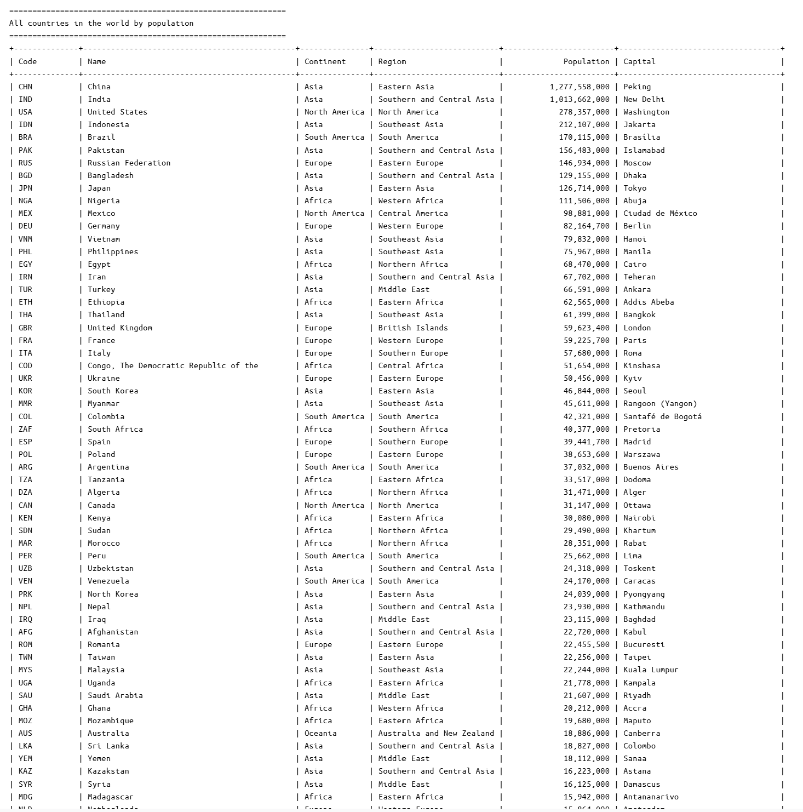 |
| 2 | All the countries in a continent organised by largest population to smallest. | Yes | 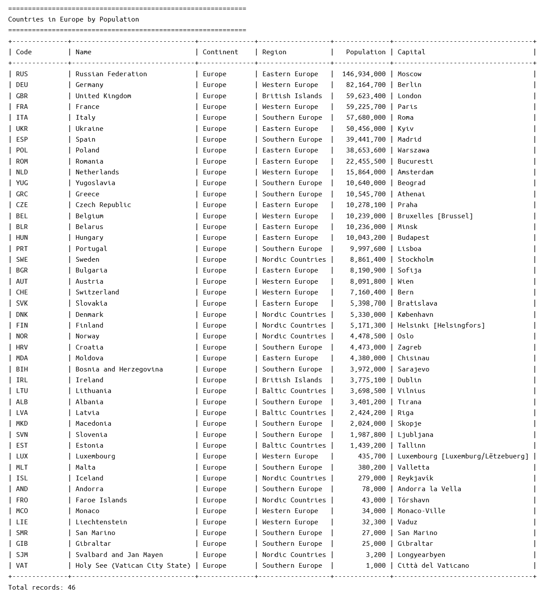 |
| 3 | All the countries in a region organised by largest population to smallest. | Yes | 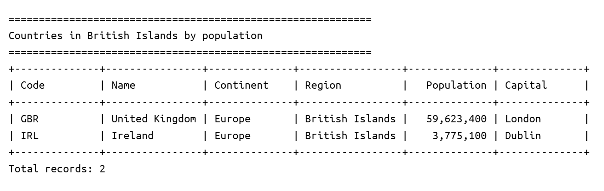 |
| 4 | The top N populated countries in the world where N is provided by the user. | Yes | 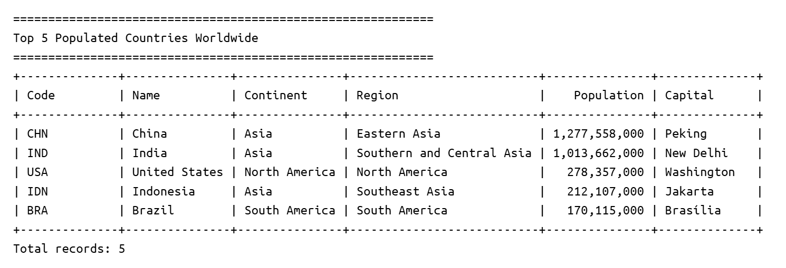 |
| 5 | The top N populated countries in a continent where N is provided by the user. | Yes | 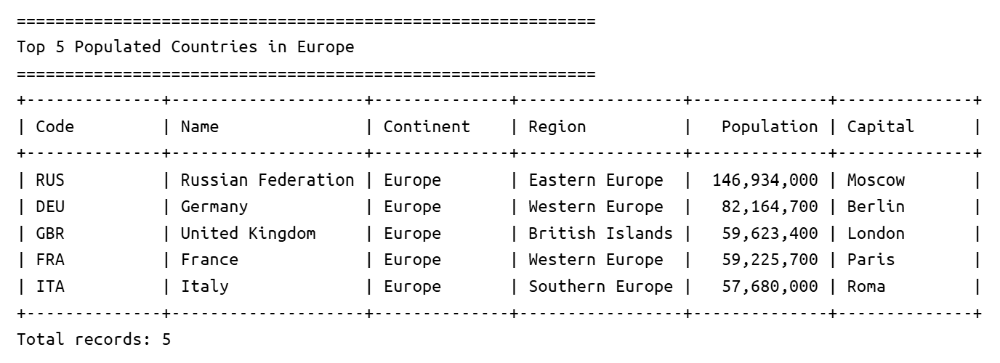 |
| 6 | The top N populated countries in a region where N is provided by the user. | Yes | 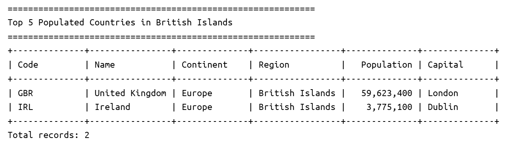 |
| 7 | All the cities in the world organised by largest population to smallest. | Yes | 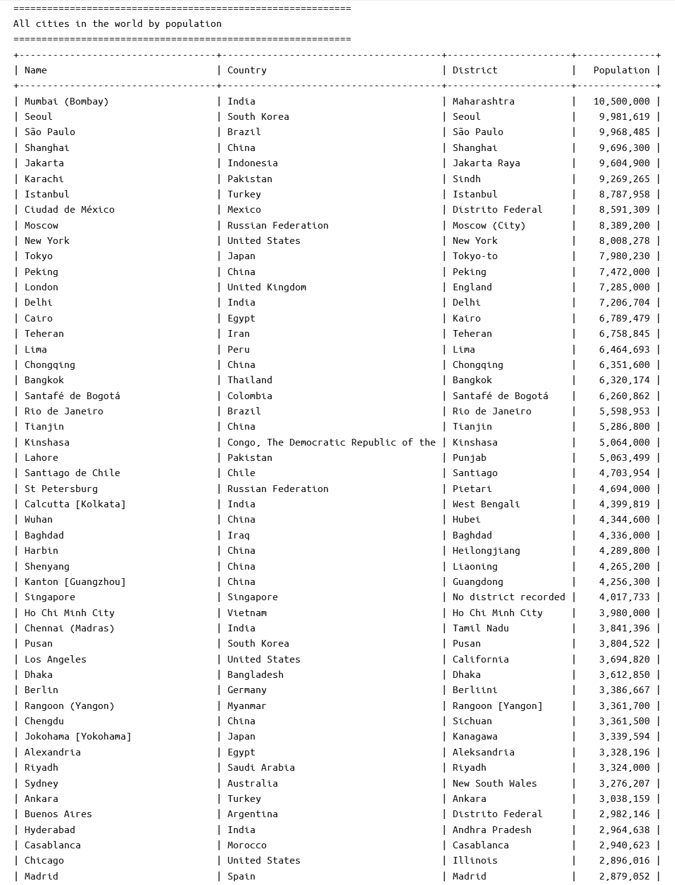 |
| 8 | All the cities in a continent organised by largest population to smallest. | Yes | 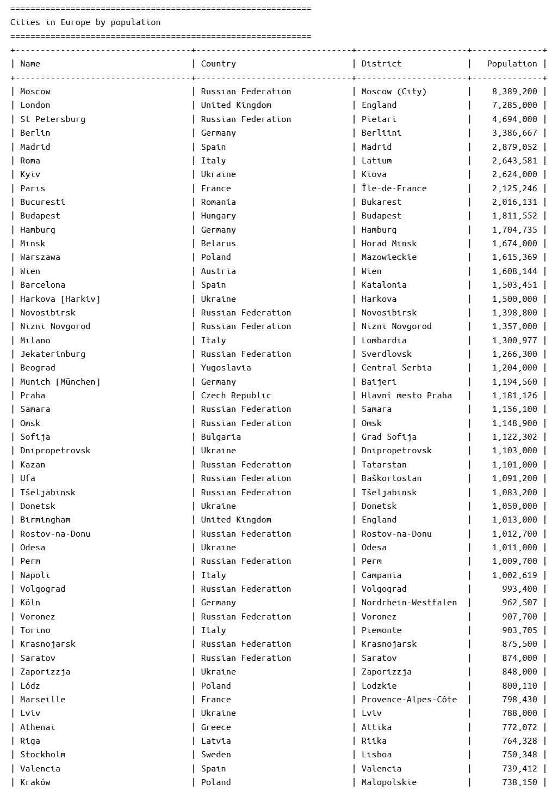 |
| 9 | All the cities in a region organised by largest population to smallest. | Yes | 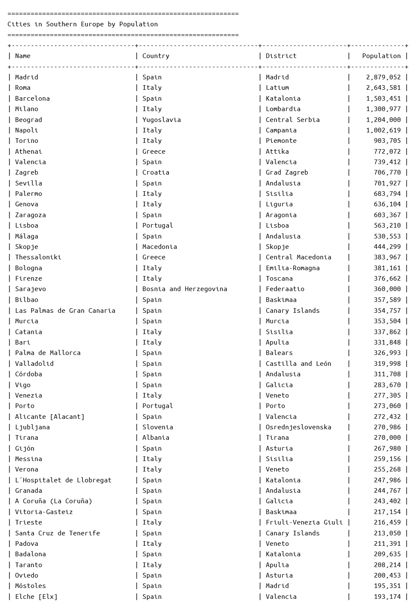 |
| 10 | All the cities in a country organised by largest population to smallest. | Yes | 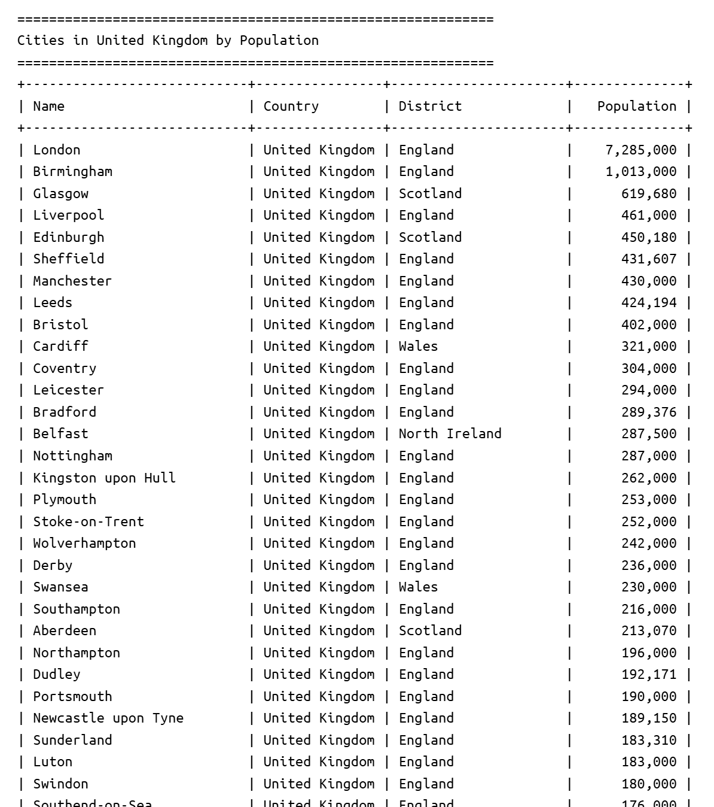 |
| 11 | All the cities in a district organised by largest population to smallest. | Yes | 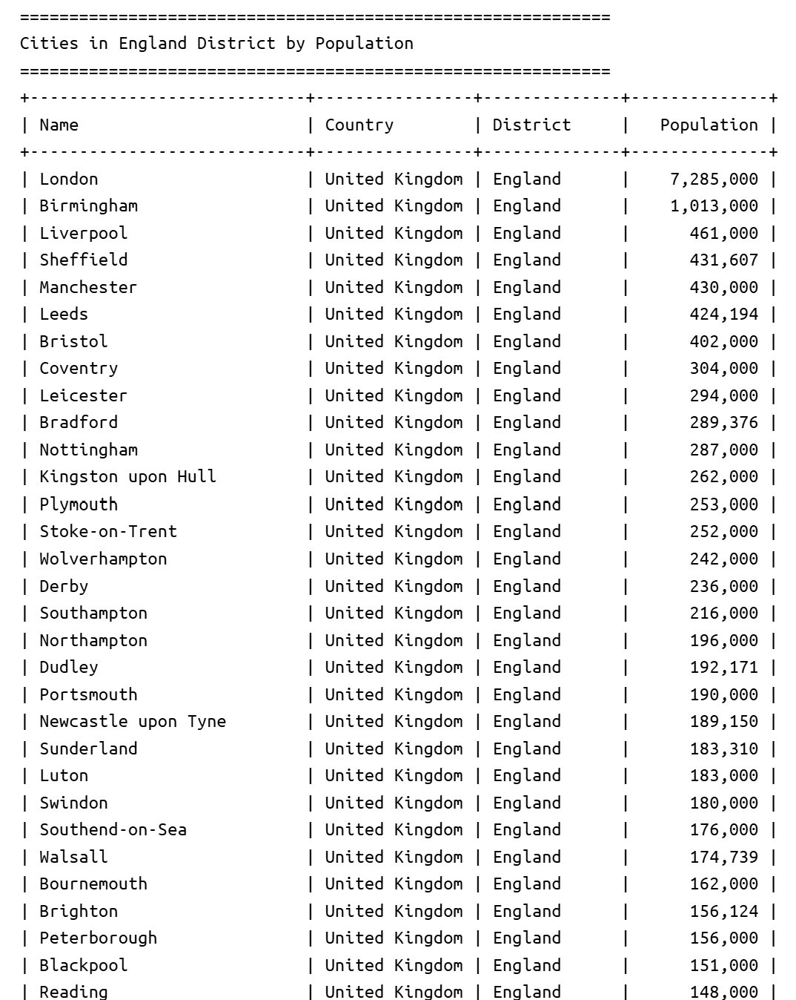 |
| 12 | The top N populated cities in the world where N is provided by the user. | Yes | 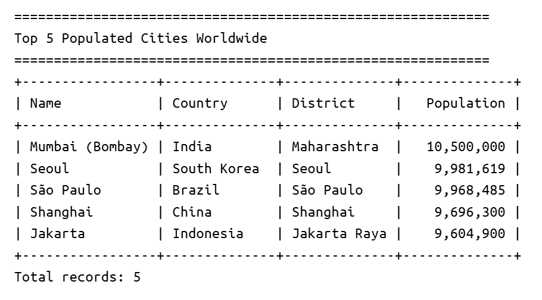 |
| 13 | The top N populated cities in a continent where N is provided by the user. | Yes | 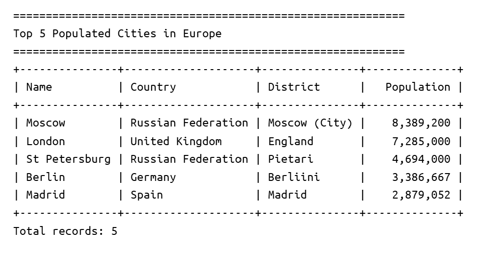 |
| 14 | The top N populated cities in a region where N is provided by the user. | Yes | 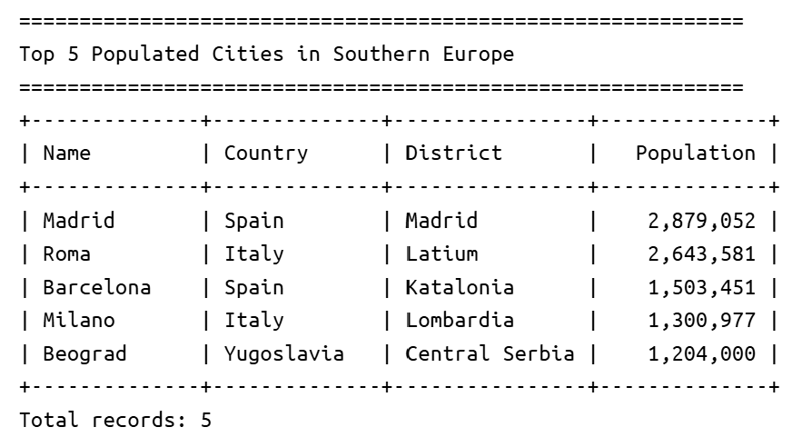 |
| 15 | The top N populated cities in a country where N is provided by the user. | Yes | 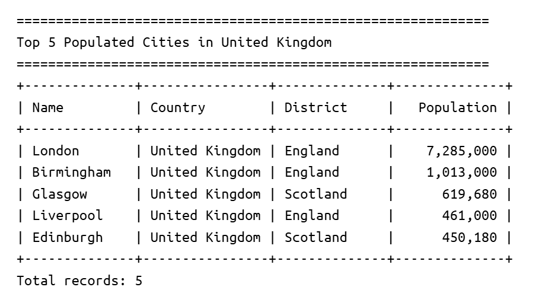 |
| 16 | The top N populated cities in a district where N is provided by the user. | Yes | 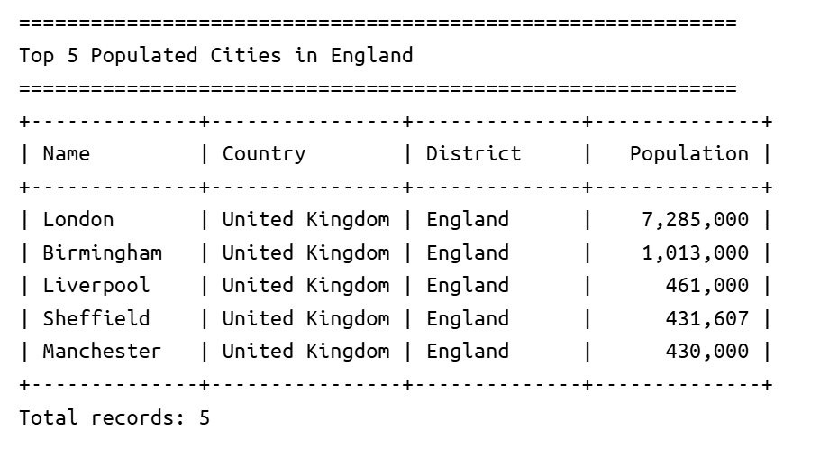 |
| 17 | All the capital cities in the world organised by largest population to smallest. | No | |
| 18 | All the capital cities in a continent organised by largest population to smallest. | No | |
| 19 | All the capital cities in a region organised by largest to smallest. | No | |
| 20 | The top N populated capital cities in the world where N is provided by the user. | No | |
| 21 | The top N populated capital cities in a continent where N is provided by the user. | No | |
| 22 | The top N populated capital cities in a region where N is provided by the user. | No | |
| 23 | The population of people, people living in cities, and people not living in cities in each continent. | No | |
| 24 | The population of people, people living in cities, and people not living in cities in each region. | No | |
| 25 | The population of people, people living in cities, and people not living in cities in each country. | No | |
| 26 | The population of the world. | No | |
| 27 | The population of a continent. | No | |
| 28 | The population of a region. | No | |
| 29 | The population of a country. | No | |
| 30 | The population of a district. | No | |
| 31 | The population of a city. | No | |
| 32 | The number of people who speak Chinese, English, Hindi, Spanish and Arabic from greatest number to smallest, including the percentage of the world population. | No | |

## Project Management

The team follows Scrum. The Product Backlog, Kanban board and Sprints are managed in Zube.io, which is connected to this GitHub repository. Work is written as user stories in GitHub Issues.

- [Zube.io project board](https://zube.io/team14/population-report-system/w/workspace-1/kanban)
- [GitHub Issues](https://github.com/Eithadarphyu2/Population-Report-System/issues)

### Releases

All releases are listed on the [Releases page](https://github.com/Eithadarphyu2/Population-Report-System/releases).

### Branching Strategy (GitFlow)

| Branch | Purpose |
|---|---|
| `master` | Released, stable code. Every release is tagged. |
| `develop` | Integration branch for completed features. |
| `release` | Release preparation and final checks before merging to `master`. |
| `Report/<name>` | Feature branches for report development. |
| `use-case/<name>` | Feature branches for use case work. |
| `project-setup/<name>` | Feature branches for project set-up. |

All changes reach `develop` and `master` through pull requests.

## Individual Contribution Spreadsheet

The following table records individual contributions. The team agreed the scores before submission.

| Matriculation Number | Code Review 1 | Code Review 2 |
|---|---:|---:|
| 40840502 | 16.73 | — |
| 40840476 | 16.73 | — |
| 40841070 | 16.37 | — |
| 40841079 | 16.73 | — |
| 40840491 | 16.73 | — |
| 40840485 | 16.73 | — |
| **Total** | **100** | **—** |
